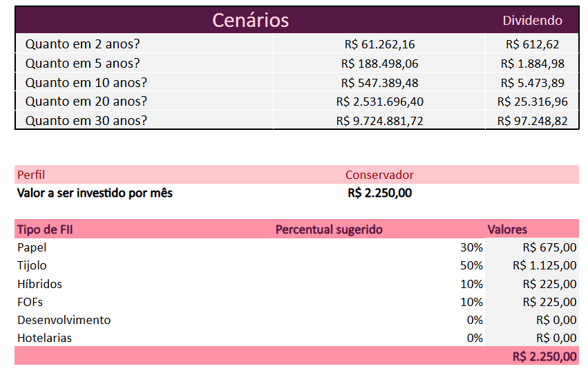
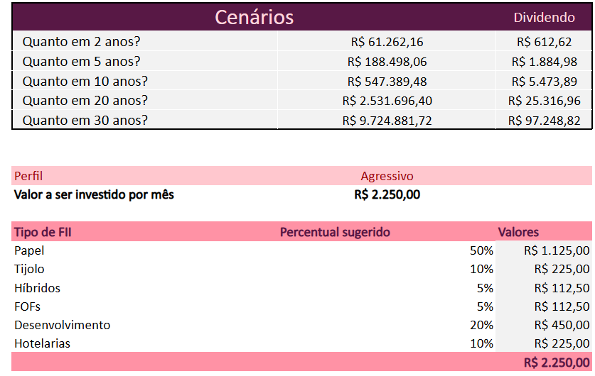

# Girl Invests: controle de investimento em FIIs

Planilha que simula quanto um aporte mensal rende ao longo dos anos e sugere como dividir esse aporte entre tipos de fundos imobiliários (FIIs), de acordo com o perfil de investidor escolhido.

> **Aviso:** o salário, o aporte e a taxa que aparecem no arquivo são **valores de exemplo**, não dados reais. A planilha é uma ferramenta de estudo e simulação. Não é recomendação de investimento.

**Arquivo:** `girl_invests_controle_de_investimento.xlsx`

## Como usar

1. Abra a aba `APP`.
2. Preencha as células de entrada: `D12` (salário), `D13` (rendimento da carteira), `D17` (quanto investir por mês), `D18` (anos) e `D19` (taxa de rendimento mensal).
3. Escolha o perfil na lista suspensa de `C31`: Conservador, Moderado ou Agressivo.
4. Leia as respostas na própria aba `APP`.

## As perguntas que a ferramenta responde

As cinco perguntas ficam no bloco "Investimento mensal", na aba `APP`:

| # | Pergunta | Onde aparece | Como é obtida |
|---|---|---|---|
| 1 | Quanto investir por mês? | `D17` | Entrada. A sugestão em `D14` é 30% do salário |
| 2 | Por quantos anos? | `D18` | Entrada |
| 3 | Qual a taxa de rendimento mensal? | `D19` | Entrada |
| 4 | Qual o patrimônio acumulado? | `D20` | `VF` sobre os aportes mensais |
| 5 | Quanto recebo de dividendos por mês? | `D21` | 1% ao mês sobre o patrimônio acumulado |

Além das cinco perguntas, a aba `APP` traz:

- **Cenários (`A24:D28`):** patrimônio acumulado e dividendo mensal em 2, 5, 10, 20 e 30 anos, com o mesmo aporte e a mesma taxa.
- **Divisão do aporte por perfil (`B31:D41`):** o percentual e o valor em reais que vai para cada tipo de FII (Papel, Tijolo, Híbridos, FOFs, Desenvolvimento e Hotelarias). A soma dos valores em `D41` confere com o aporte.

## Como o VF e o PROCV entram nos cálculos

No Excel em português, as funções se chamam `VF` e `PROCV` (em inglês, `FV` e `VLOOKUP`).

### VF (valor futuro)

Calcula quanto o dinheiro vira com aportes mensais iguais e uma taxa mensal fixa.

- **Patrimônio acumulado (`D20`):** `=VF(D19; D18*12; D17*-1)`. Usa a taxa mensal, o número de meses (anos × 12) e o aporte, que entra negativo porque é dinheiro que sai do bolso.
- **Cenários (`C24:C28`):** `=VF($D$19; $A24*12; $D$17*-1)`. A mesma conta, mudando só o número de anos, que vem da coluna `A`.
- **Dividendo dos cenários (`D24:D28`):** o patrimônio de cada cenário multiplicado por `$D$13` (rendimento da carteira).

### PROCV (busca do percentual do perfil)

Descobre qual percentual cada tipo de FII recebe no perfil escolhido. Em `C35:C40`:

```
=PROCV(Perfil & "-" & B35; Planilha2!$A$2:$D$20; 4; FALSO)
```

1. A fórmula junta o perfil escolhido e o tipo de FII numa chave de texto, por exemplo `Moderado-Tijolo`.
2. Procura essa chave na coluna `A` da tabela de percentuais (aba `Planilha2`, oculta).
3. Devolve a quarta coluna da tabela, que é o percentual.

Na aba `Planilha2`, a coluna `A` monta cada chave com `=B3&"-"&C3`, ou seja, perfil e tipo de FII separados por hífen. Ao trocar o perfil em `C31`, todas as chaves procuradas mudam e a divisão do aporte muda junto.

> A aba `Planilha2` está oculta. Para vê-la: clique com o botão direito em qualquer aba, escolha "Reexibir" e selecione `Planilha2`.

## Intervalos nomeados

| Nome | Refere-se a | Conteúdo | Usado em fórmula |
|---|---|---|---|
| `aporte` | `APP!D17` | Quanto investir por mês | Sim, em `C32` (valor a ser dividido entre os FIIs) |
| `Perfil` | `APP!C31` | Perfil escolhido na lista | Sim, nos `PROCV` de `C35:C40` |
| `qtd_anos` | `APP!D18` | Número de anos | Não, é um nome de apoio |
| `taxa_mensal` | `APP!D19` | Taxa de rendimento mensal | Não, é um nome de apoio |
| `patrimonio` | `APP!D20` | Patrimônio acumulado | Não, é um nome de apoio |
| `rendimento_carteira` | `APP!D13` | Rendimento da carteira | Não, é um nome de apoio |

`Perfil` é o intervalo que criei. Os outros cinco já existiam na ferramenta original, com os mesmos nomes. A original também tinha `salario` (`D12`) e `sugestao_investimento` (`D14`), que não mantive.

## Percentuais de cada perfil

A tabela fica na aba `Planilha2` (`B3:D20`). Cada perfil soma 100%.

| Tipo de FII | Conservador | Moderado | Agressivo |
|---|---|---|---|
| Papel | 30% | 32% | 50% |
| Tijolo | 50% | 35% | 10% |
| Híbridos | 10% | 8% | 5% |
| FOFs | 10% | 5% | 5% |
| Desenvolvimento | 0% | 10% | 20% |
| Hotelarias | 0% | 10% | 10% |
| **Soma** | **100%** | **100%** | **100%** |

**De onde vieram:** das aulas do Felipe Aguiar. Os valores são os mesmos da ferramenta original (aba `Planilha2`, coluna `D`); não alterei nenhum percentual.

## O que mudei em relação à ferramenta do Expert

**O que mantive:** a estrutura geral (aba `APP` e tabela de percentuais em outra aba), as cinco perguntas, os cenários de 2, 5, 10, 20 e 30 anos, a taxa mensal de 1,079%, a lista com os três perfis e os percentuais de cada perfil.

**O que mudei:**

- **Intervalo nomeado `Perfil`:** criei o nome `Perfil` (`APP!C31`) e os `PROCV` passaram a usá-lo no lugar de `$C$32`.
- **Intervalo fixo no `PROCV`:** a busca agora é em `Planilha2!$A$2:$D$20`, e não nas colunas inteiras `Planilha2!$A:$D`.
- **Aba oculta:** a aba `Planilha2` fica oculta (na original ficava visível).
- **Textos:** títulos e rótulos que estavam em maiúsculas (`PERFIL`, `TIPO DE FII`, `PAPEL`...) passaram para formato de frase (`Perfil`, `Tipo de FII`, `Papel`...), inclusive as chaves da tabela de percentuais.
- **Layout do bloco de perfil:** o seletor de perfil sobe uma linha (para `C31`), a soma dos valores fica em `D41` e a célula do seletor é rosa (amarela na original).
- **Valores de exemplo:** salário de R$ 7.500 (original: R$ 2.000), aporte de R$ 2.250 (original: R$ 200) e rendimento da carteira de 1% (original: 0,6%).
- **Fórmulas de patrimônio, dividendos e cenários** (`D20`, `D21` e `D24:D28`): usei referências de célula, e o dividendo mensal usa 1% fixo na fórmula. A original usava os nomes `taxa_mensal`, `qtd_anos`, `aporte`, `patrimonio` e `rendimento_carteira` nessas fórmulas.

## Evidência de que funciona

Mesma simulação nos dois perfis: salário de exemplo R$ 7.500, aporte de R$ 2.250 por mês, 5 anos e taxa de 1,079% ao mês. O patrimônio acumulado é o mesmo (R$ 188.498,06), porque o perfil só muda a divisão do aporte.

| Tipo de FII | Conservador | Agressivo |
|---|---|---|
| Papel | R$ 675,00 | R$ 1.125,00 |
| Tijolo | R$ 1.125,00 | R$ 225,00 |
| Híbridos | R$ 225,00 | R$ 112,50 |
| FOFs | R$ 225,00 | R$ 112,50 |
| Desenvolvimento | R$ 0,00 | R$ 450,00 |
| Hotelarias | R$ 0,00 | R$ 225,00 |
| **Total** | **R$ 2.250,00** | **R$ 2.250,00** |

Os prints mostram os cenários e a divisão do aporte. Os cenários são iguais nos dois perfis, e só a divisão do aporte muda.

| Perfil Conservador | Perfil Agressivo |
|---|---|
|  |  |

## Limitações

- A simulação usa uma taxa mensal fixa e aportes iguais todos os meses. Não considera inflação, impostos, variação do preço das cotas nem mudança nos dividendos.
- O dividendo mensal é calculado como 1% do patrimônio acumulado.
- Os percentuais por perfil são uma referência de estudo, não uma recomendação.
